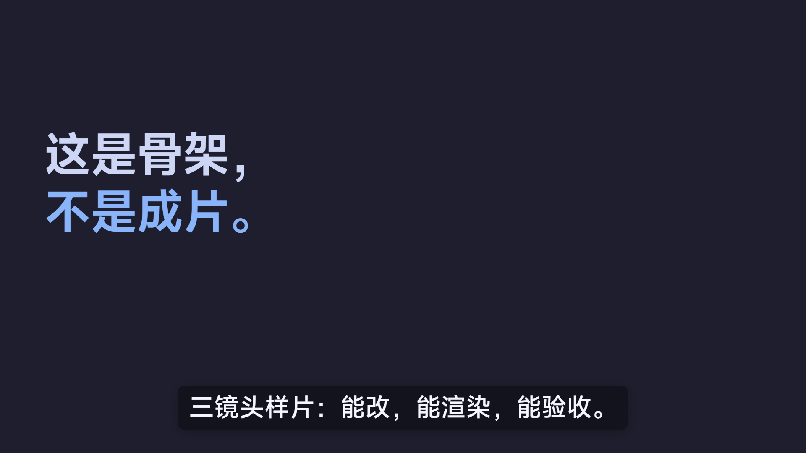

<div align="center">

# 大肥鱼影业 · dsh-Studios

**从一句话主张到出片，一条能改第二遍的生产线。**

一支片子 = 一个目录 = 一份定稿派生出的时间轴、清单和镜头。

<br>




<sub>骨架自带的三镜头样片，零素材就能装、能起、能出片。</sub>

</div>

---

## 这是什么

不是模板库，也不是剪辑软件。是一台**把定稿变成成片**的机器，加一条**验收门**。

它解决的不是「怎么剪得更好看」，是**改第二遍的时候不用重搭一遍**：

| 没有它 | 有它 |
|---|---|
| 画面改了字幕没跟上 | 时间只写在一处，改一处全片跟着对 |
| 加一个镜头要动四个文件 | 注册表加一行，装配文件不碰 |
| 交出去的是 mp4，对方改一个字得重做 | 交出去的是能改、能验、能复刻的工程 |
| 验收靠「我看过了」 | 验收是一条命令 + 一份敢写「这条我验不了」的清单 |

## 三十秒上手

```sh
git clone https://github.com/CAI991108/dsh-studios.git
cd dsh-studios

# 开一支新片（自带三镜头空骨架，零素材也能跑）
node scripts/new-film.mjs ../我的新片

cd ../我的新片
npm install
npm run qa        # 验收门：定稿状态 / 时间轴 / 素材 / 泄漏 / 类型
npm run start     # 起编辑台，浏览器里改字拖时间
npm run render    # 出带配乐版 + 无配乐版 + 封面
```

首次 `npm run render` 会自动下载 Remotion 的渲染浏览器（约 113MB）。`npm start` 端口被占会自己换一个，只绑 `127.0.0.1`。

## 一条派生链

```
定稿.json ──npm run derive──▶ film/timing.json ──Film.tsx──▶ film/workbench.ts ──▶ 编辑台 / 渲染
（人写，唯一源头）              （生成，唯一时间轴）            （静态，通用）
```

箭头只朝右。右边的东西改了，下一次派生就没了——所以没人会去改。

片子之间的差异只剩三个地方：

| 想改什么 | 改哪 |
|---|---|
| 长相：配色、字体、字幕版式 | `film/film.config.json` |
| 时间：每拍多长、旁白入点、音效钉点 | `定稿.json`（然后 `npm run derive`） |
| 画面：新增一种镜头 | `film/scenes/` + 注册表一行 |

## 仓库里有什么

| 路径 | 是什么 |
|---|---|
| [`SKILL.md`](SKILL.md) | 生产线本体。装进 DSH 后，模型在「做视频」类请求上自己取用它 |
| [`references/protocol.md`](references/protocol.md) | 三份数据的契约：定稿 → 时间轴 → 工作台清单 |
| [`references/gates.md`](references/gates.md) | 三道门：定稿门、自动验收、人工验收 |
| `scripts/new-film.mjs` | 开新片：复制骨架 + 装字体 + 首次派生 |
| `template/` | 骨架本体。`Film.tsx` / `workbench.ts` 通用，三镜头开箱即用 |
| `assets/fonts/` | MiSans 字体与授权（骨架不带 19MB 字体，开片时复制进去） |
| [`GLOSSARY.md`](GLOSSARY.md) | 一个概念一个词：拍 / 幕 / 场景 / 定稿 / 派生 / 接缝 / 门 |
| [`docs/`](docs/) | 方法论、ADR、第一次实战的记录 |

## 生产线：七步

每一步都有一条能判的完成标准，不是「感觉差不多了」。

| # | 步骤 | 干什么 | 完成标准 |
|---|---|---|---|
| 0 | 开局 | `new-film.mjs` 立起空工程 | `qa` / `start` / `render:check` 都通 |
| 1 | 本子 | 在 `定稿.json` 每拍写一条 | `npm run qa -- --draft` 全绿 |
| 2 | 声音 | 旁白逐拍出文件，回填真实帧数 | `qa` 不报素材缺文件 |
| 3 | 定稿门 | 逐条把 `status` 推到 `已定` | `qa` 通过且无一条未定 |
| 4 | 装配 | 缺的镜头类型补进 `scenes/` | `render:check` 里有画面，不是红底告示 |
| 5 | 监看 | 编辑台里改字、调节奏 | 改通一条字幕并实时预览 |
| 6 | 出片 | `render` + `qa` | `exports/` 有片，台账无空缺 |

## 三道门

**定稿门** 是唯一必须人点头的地方。`定稿.json` 的 `status` 是一个只进不退的状态机：`待定 → 待选 → 提议 → 待改 → 已定`。agent 可以写 `提议`、可以反复改，把 `提议` 翻成 `已定` 的那一下是人。

**自动验收** `npm run qa` 查：定稿状态、时间轴首尾相接、素材文件存在、凭据与绝对路径泄漏、`tsc --noEmit`（覆盖 `src` **和** `film`）、产物不是坏片。

**人工验收** 只能人做：逐帧看隐私（余额、邮箱、通知、真实姓名）、听一遍混音、核一遍版权与数据口径。

> 自动门挡住机械错误，人门挡住判断错误。`qa` 只判能自动判的那半，这份诚实是设计的一部分。

## 第一次实战

这套东西是从一支真片子里抽出来的：`omarchy-NTE · 生产力，稍后再说`，2 分 03 秒，17 个镜头、66 条字幕、5 条轨道。

那支片子的前后两半其实都有了——前半段是定稿清单和分镜，后半段是 Remotion 工程和编辑台——**但两半是手工接的**：`film/workbench.ts` 那 8 行每片重写一次。这条线把手工接缝换成了 `npm run derive`。

细节和代价：[`docs/case-omarchy-nte.md`](docs/case-omarchy-nte.md) · 决策记录：[`docs/adr/0004`](docs/adr/0004-converge-into-a-pipeline.md)

## 常见问题

<details>
<summary><b>30 秒的片子值得上这套吗</b></summary>

不值得。判据只有一条——**会不会改第二遍**。一次成型的短片直接 ffmpeg 拼更快，别为了流程而流程。
</details>

<details>
<summary><b>为什么每支片子复制一份骨架，而不是共用一个工作台</b></summary>

共享工作台要靠符号链接接入工程，Windows 上建链接要开发者模式，交付给别人的第一步就断。一份 0.7MB 的副本换「解压即用」，值。代价写在 ADR 里。
</details>

<details>
<summary><b>骨架升级了，老片子怎么跟</b></summary>

不跟。每支片子是骨架的冻结副本，做完即归档。要长期维护一支片子，就把它当独立仓库。
</details>

<details>
<summary><b>能不做配音，只用字幕吗</b></summary>

能。旁白是可选的一层，`定稿.json` 的 `voice` 留空即可，时间轴和出片都不需要它。
</details>

<details>
<summary><b>一定要用 Remotion 吗</b></summary>

这套机器是围绕「影片即代码」建的：能 diff、能 review、能批量改文案、能精确到帧。换成时间线工程文件，这三个好处全没了。
</details>

## 声明

- 字体：小米 MiSans，授权原文与 NOTICE 在 [`assets/fonts/`](assets/fonts/)。
- 仓库不含任何凭据、密钥或本机绝对路径；`npm run qa` 每次都会重扫一遍。
- 第一支片子的完整工程（源码、素材、成片）留在本地 `_archive/`，不入库。

<div align="center">
<sub>把片子当成一个可验证的软件交付物：单一真相、代码化、素材可溯、可编辑、有记录、有复核。</sub>
</div>
